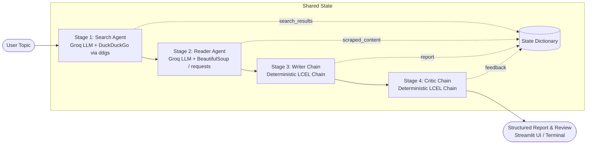

# ResearchMind: Multi-Agent Research System

An autonomous multi-agent research system that takes any research topic and, with zero manual intervention, performs targeted web search, in-depth web content extraction, report synthesis, and independent critical review.

---

## 🏗 System Architecture



### Why Agents for Stages 1 & 2, but Chains for Stages 3 & 4?
- **Search & Reader (Agents with Tool Calling):** These stages require autonomous decision-making (generating effective search queries, inspecting search results, and selecting which URL to fetch and scrape).
- **Writer & Critic (Deterministic LCEL Chains):** Writing and critiquing are fixed single-pass operations (prompt in, text out). A deterministic LCEL chain (`prompt | llm | StrOutputParser()`) is simpler, cheaper, faster, and more predictable without looping risks.

---

## 📁 Project Structure

```text
new_gen_ai_project/
├── .env                  # Groq API credentials (never committed)
├── .env.example          # Safe template for environment variables
├── .gitignore            # Git ignore rules (.env, .venv, __pycache__)
├── requirements.txt      # Pinned core & helper dependencies
├── tools.py              # LangChain @tool definitions (web_search, scrape_url)
├── agents.py             # ChatGroq LLM, 2 agents (create_agent), 2 LCEL chains
├── pipeline.py           # Terminal supervisor (run_research_pipeline)
└── app.py                # Polished Streamlit UI with animated step cards
```

---

## 🚀 Quickstart Guide

### 1. Prerequisites
- Python 3.10+ (tested on Python 3.12 and 3.13)
- `uv` (recommended) or `pip`
- A free Groq API key from [console.groq.com](https://console.groq.com)

### 2. Environment Setup
```bash
# Clone or navigate to the repository
cd new_gen_ai_project

# Create and activate virtual environment
uv venv --python 3.12
source .venv/bin/activate  # On Windows: .venv\Scripts\activate

# Install dependencies
uv pip install -r requirements.txt
```

### 3. Configure API Keys
Copy `.env.example` to `.env` and fill in your Groq API credentials:
```bash
cp .env.example .env
```
Inside `.env`:
```env
GROQ_API_KEY=gsk_your_groq_api_key
GROQ_MODEL=openai/gpt-oss-120b
```

### 4. Run the Pipeline

#### Terminal Mode
```bash
python pipeline.py "DeepSeek V3 Architecture"
```

#### Streamlit Web UI Mode
```bash
streamlit run app.py
```
Open `http://localhost:8501` in your browser.

---

## ⚙️ Technical Highlights

- **LangChain 1.x & LangGraph:** Employs modern `create_agent` architecture with clear tool schemas (`args_schema`) and structured system prompts.
- **Tenacity Retries:** DuckDuckGo search calls automatically retry with exponential backoff if rate limits or network issues occur.
- **Clean HTML Stripping:** Scraping strips scripts, styles, headers, footers, and navigation elements using `lxml` / `BeautifulSoup4` with an 8-second timeout and browser-like user agent.
- **Token Budget Guardrails:** Search snippets are capped at 300 characters and scraped text at 3,000 characters to prevent context window overflow and keep Groq free-tier latency low.
- **Streamlit Reactive State:** Session state preserves pipeline progress across reruns and visualizes each stage through status badges and expandable inspection tabs.

